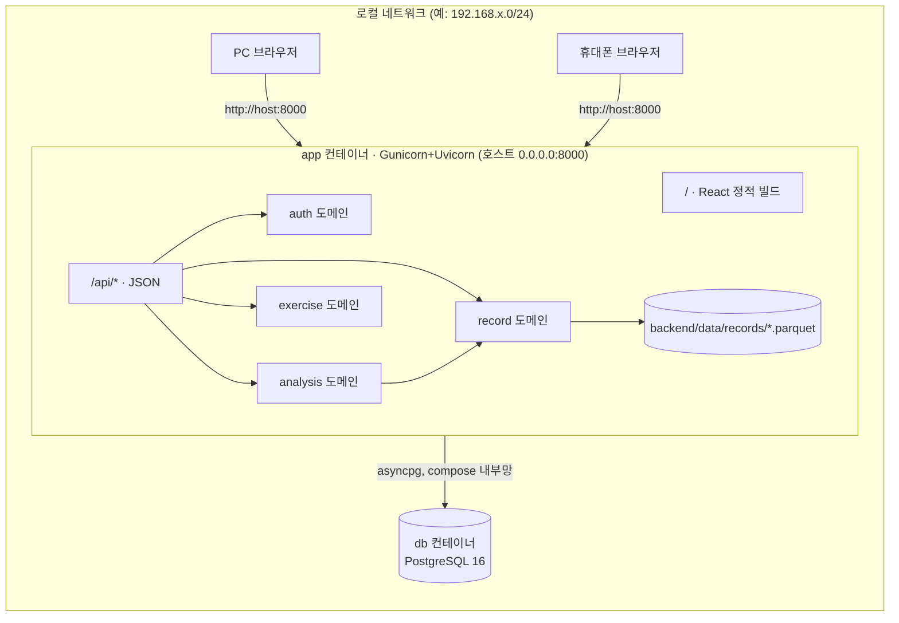

# 현행 아키텍처

gait-insight는 공개 보행 기록을 분석해 좌우 하중·접촉 시간·걸음 리듬·앞뒤 하중 분포를 보여주고, 학과가 검토한 규칙으로 운동정보를 연결하는 웹 프로토타입이다. 실 상용 목적이 아니므로 서버와 PostgreSQL을 로컬 PC에서 Docker Compose로 띄우고, 같은 로컬 네트워크의 PC·휴대폰 브라우저가 접속하는 구성으로 한정한다. 인터넷 공개와 실시간 센서 연동은 없다. 로그인은 아이디·비밀번호 최소 구성이다.

이 문서는 지금 구조와 경계만 설명한다. 왜 이렇게 정했는지와 화면·API·계산 정의는 [설계 제안 0001~0005](../design)에 있다. 설계 동결 후의 변경 이유는 `docs/adr`에 쌓인다(아직 없음). 화면 골격은 [설계 0005](../design/0005-frontend-screens.md)와 [프로토타입 기록](../prototype/mockup-player.md)을 따른다.

## 구조 요약



컨테이너는 `app`과 `db` 둘이고 `docker compose up --build`로 함께 뜬다. `app` 안의 FastAPI가 `/api` 아래에 JSON을 제공하고, 같은 프로세스가 이미지에 포함된 React 빌드 결과를 `/`에서 정적으로 서빙한다. 브라우저는 주소 하나만 안다. 기록 메타·운동 콘텐츠·규칙 세트·분석 결과는 PostgreSQL에 있고, 센서 시계열만 parquet 파일이다. DB 내용의 변경 이력은 `backend/data/seed/*.json`을 통해 git이 갖는다.

## 구성요소와 책임

| 구성요소 | 위치 | 책임 | 정본 |
| --- | --- | --- | --- |
| 화면 | `frontend/src/` | 기록 선택, 분석 스테이지(히트맵·재생 독·그래프·지표 타일), 운동정보 스텝 플로우. 상태는 화면 안에서만 관리 | React 코드 |
| 데이터 창구 | `frontend/src/data/` | `listRecords`·`getRecord`·`getAnalysis`·`getExercise` 네 함수. 실제 모드는 `/api`, 목업 모드는 내장 fixture | TypeScript 타입 `frontend/src/types/` |
| API | `backend/app/domain/*/api.py` | 도메인별 라우터. `/api/<domain>` 아래 자동 등록 | Swagger UI (`/docs`) |
| auth 도메인 | `backend/app/domain/auth/` | 가입·로그인·로그아웃·현재 사용자. bcrypt 해시, HS256 JWT httpOnly 쿠키. 다른 도메인에 `current_user` 의존성 제공 | `app_user` 테이블 |
| record 도메인 | `backend/app/domain/record/` | 기록 메타(`record` 테이블) 조회, parquet 로드, 표시용 다운샘플 | `record` 테이블 + `backend/data/records/` |
| analysis 도메인 | `backend/app/domain/analysis/` | 정적·보행 구간과 접촉 검출, 지표 M01~M10 계산, 활성 규칙 세트로 관찰·보행 유형 판정·운동 프로그램 연결, 결과 캐시(`analysis_result`), 설명문 조립 | `metrics.py` + `rule_set`·`link_rule` 테이블 |
| exercise 도메인 | `backend/app/domain/exercise/` | 운동 콘텐츠(`exercise` 테이블) 조회. 검토 상태 포함 | `exercise` 테이블 |
| 컨테이너 | `docker-compose.yml`, `Dockerfile`, `backend/entrypoint.sh` | `db`(postgres:16, 볼륨)와 `app`(멀티스테이지: node로 frontend 빌드 → python:3.12-slim + uv). entrypoint가 마이그레이션·seed 후 Gunicorn을 띄운다 | compose·Dockerfile |
| DB | `backend/alembic/` | PostgreSQL 16 스키마는 Alembic 마이그레이션, 초기 데이터는 `tools/seed.py` | Alembic revision + `backend/data/seed/` |
| 데이터 준비 도구 | `backend/tools/` | 합성 기록 생성(`synth.py`·`make_records.py`), seed 적재(`seed.py`). PhysioNet 내려받기·선별·변환은 아직 없다 | 실행 기록은 `docs/reports/` |
| 문구 | `frontend/src/locales/ko.json`, `backend/app/core/locales/ko.json` | 사용자 문장 전부. 코드에 한국어 하드코딩 없음 | locale JSON |

각 도메인 폴더는 `api.py`·`service.py`·`crud.py`·`schemas.py`·`models.py`를 갖는다. 도메인 사이 참조는 analysis → record, analysis → exercise, 그리고 모든 도메인 → auth(`current_user`)뿐이며 record·exercise는 서로 모른다.

## 주요 흐름

기록 재생과 분석은 요청 한 번씩이다. 실시간 통신은 없다.

```text
0. 로그인          POST /api/auth/register | login → httpOnly 쿠키. 이후 요청은 쿠키로 인증, 없으면 401
1. 기록 선택       GET /api/record            → 목록 (id, 표시명, 길이, 출처, 스파크라인용 6초 요약)
2. 분석 화면 진입  GET /api/record/{id}       → 시간·좌8·우8·합계 (표시용 해상도)
                   GET /api/analysis/{id}     → 분석 구간, M01~M10, 관찰 판정, 보행 유형별 운동 ID·이유·재평가 항목, 설명문, 규칙 세트 버전
                                                (analysis_result 캐시 적중 시 계산 생략)
3. 재생            브라우저 안에서만 진행. state.t 하나를 히트맵·그래프·시크바가 공유
4. 운동정보        GET /api/exercise/{id}     → 이름·목적·방법·유의사항·출처·검토 상태 (특징별로 호출)
```

분석 응답은 서버가 계산하며 브라우저는 표시만 한다. 계산할 수 없는 지표는 `ok: false`와 이유를 반환하고, 화면은 그 지표 타일을 "계산 불가"로 그린다. 0으로 채우지 않는다.

시연 기동은 `docker compose up --build` 하나이며 절차는 [시연 runbook](../runbook/local-demo.md)에 있다. `app` entrypoint가 `alembic upgrade head` → `seed.py` → Gunicorn 순으로 실행한다. 개발 중에는 `docker compose up -d db`만 띄우고 호스트에서 `uv run uvicorn --reload`와 `npm run dev`를 쓴다. 호스트 PC의 방화벽이 8000 포트를 허용해야 휴대폰이 접속하며, 5432는 compose 내부망에만 있다. 절차는 후속 runbook에서 다룬다.

## 제약과 근거

- **Docker Compose 단일 스택, 로컬망 전용.** 호스트에 공개하는 포트는 8000 하나이고 공유기 밖으로 열지 않는다. 인증·TLS·Nginx를 두지 않는 근거는 [설계 0002](../design/0002-infrastructure-and-runtime.md) 결정과 대안 절이다.
- **PostgreSQL + parquet 하이브리드.** 메타·콘텐츠·규칙·결과는 DB, 센서 시계열은 parquet이다. 스키마 변경은 Alembic revision으로만 한다. 근거는 [설계 0003](../design/0003-data-model-and-storage.md) 결정과 대안 절이다.
- **지표 정의의 정본은 Python.** 목업의 `analyze()`를 이식하되, 임계값은 활성 `rule_set`에서 읽는다. 시연용 세트와 학과 검토 세트를 버전으로 구분한다. 근거는 [설계 0004](../design/0004-api-and-analysis.md) 결정과 대안 절이다.
- **인증은 최소.** 비밀번호 규칙·이메일 인증·찾기·권한 등급이 없고 서버는 세션을 저장하지 않는다. TLS가 없어 쿠키에 `Secure`를 붙이지 않는다. 근거는 [설계 0004](../design/0004-api-and-analysis.md) 결정과 대안 절이다.
- **AI는 선택.** 설명문은 템플릿이 기본이며, LLM은 계산 결과와 이미 연결된 운동만 입력받아 풀어쓰는 역할로 한정한다. 키는 서버 `.env`에만 둔다. 이번 단계에서는 구현하지 않는다.
- **갱신 조건.** 도메인 추가·삭제, API 경로 변경, 테이블 추가·삭제, 저장 형식 변경, 배포 방식 변경이 있으면 이 문서를 같이 고치고 `last-reviewed`를 올린다.
