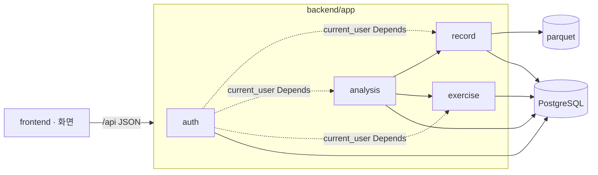

# 0001. 시스템 아키텍처

목업(`docs/mockup/gait-insight-demo.html`, 플레이어 골격·기본 테마 코발트)의 화면·조작·지표 계산을 그대로 실제 버전으로 옮긴다. 실제 버전은 React 화면과 FastAPI 서버 하나, PostgreSQL 하나로 구성하고 Docker Compose로 함께 띄우며, 호스트 PC의 컨테이너에 같은 로컬망의 PC·휴대폰이 접속한다. 이 문서는 목표·범위와 전체 구조, 도메인 경계, 검증, 구현 순서를 정하고 세부는 네 문서로 나눈다.

| 문서 | 다루는 것 |
| --- | --- |
| 이 문서 | 목표·범위, 최상위 구성과 도메인 경계, 검증, 구현 순서 |
| [0002 인프라와 실행](0002-infrastructure-and-runtime.md) | Docker Compose·Dockerfile·entrypoint, 네트워크·포트, 환경 변수, 실행 모드, 실행 스택 결정 |
| [0003 데이터 모델과 저장](0003-data-model-and-storage.md) | 테이블·ERD·제약, 마이그레이션·seed, parquet, PhysioNet 데이터 준비, 저장 방식 결정 |
| [0004 API와 분석 파이프라인](0004-api-and-analysis.md) | 백엔드 폴더, 인증, API 계약, 지표 M01~M10 정의, 보행 유형 판정·운동 프로그램, 지표·인증 결정 |
| [0005 프론트엔드 화면](0005-frontend-screens.md) | 프론트 폴더, 화면 상태, 데이터 창구, 목업 이식 |

검토자에게 묻는 것은 하나다. **이 범위와 방법으로 구현을 시작해도 되는가.** 다섯 문서를 함께 승인하면 동결하고, 그 뒤의 중요한 변경만 `docs/adr`에 결정 기록으로 남긴다. 임계값과 운동 연결 규칙의 값 자체는 학과 검토 대상이며 승인 범위가 아니다.

## 제안 요약

### 목표

- 기록 선택 → 분석(히트맵 재생·그래프·지표) → 운동정보 3화면을 목업과 같은 UX로 제공한다.
- PC(≥992px)와 휴대폰(≤430px) 브라우저에서 동작한다. 별도 앱은 없다.
- 전문가 자료 기준 지표 M01~M10과 보행 유형(T1~T3)을 계산하고, 계산 불가 사유를 화면까지 전달한다.
- 기록 메타·운동 콘텐츠·규칙·분석 결과를 PostgreSQL에 두어 실제 서비스와 같은 저장 뼈대를 갖춘다.
- 아이디·비밀번호 로그인을 두고 로그인한 사용자만 화면과 API를 쓴다. 최소 구성이며 비밀번호 규칙·이메일 인증·비밀번호 찾기는 없다.
- `docker compose up --build` 하나로 DB·마이그레이션·seed·서버가 올라와 로컬망 시연이 가능하다.

### 범위 밖

회원가입 승인·권한 등급·비밀번호 규칙·이메일 인증·비밀번호 찾기, 업로드, 인터넷 배포, 실시간 센서, LLM 설명(인터페이스만 남긴다), 파킨슨병 데이터·질병 분류. 근거는 [범위 문서](../../README.md)다.

### 결정 요약

| 항목 | 결정 | 근거 |
| --- | --- | --- |
| 실행 | Docker Compose `db` + `app`. `app`은 Gunicorn + Uvicorn worker의 FastAPI가 `/api`와 React 정적 빌드를 함께 서빙, 호스트 `0.0.0.0:8000` 공개 | 0002 결정과 대안 절 |
| 저장 | PostgreSQL 16(메타·콘텐츠·규칙·분석 결과) + parquet 파일(센서 시계열) | 0003 결정과 대안 절 |
| 지표 | 목업 `analyze()`를 Python으로 이식, 임계값은 DB의 활성 규칙 세트에서 읽는다 | 0004 결정과 대안 절 |
| 인증 | 아이디+비밀번호, bcrypt 해시, JWT를 httpOnly 쿠키로. `auth` 외 모든 API는 로그인 필수 | 0004 결정과 대안 절 |
| 화면 | TypeScript + React + Vite, CSS(목업 토큰 이식), 차트는 SVG 직접 그리기, 히트맵은 Canvas | 0005 |
| 패키지 | 백엔드 `uv` + `pyproject.toml`, SQLAlchemy 2.0 async + asyncpg + Alembic, 프론트 `npm` | 사용자 표준 |

## 설계

### 최상위 구성

```text
gait-insight/
  docker-compose.yml  Dockerfile  .dockerignore  .env.example   → 0002 인프라와 실행
  backend/
    app/                                                       → 0004 API와 분석
    alembic/  data/  tools/                                    → 0003 데이터 모델과 저장
  frontend/                                                    → 0005 프론트엔드 화면
  scripts/verify.sh                                            native 검증 진입점
  docs/                                                        engsys 계약에 따른 문서
```

### 도메인과 경계



| 도메인 | 책임 | 정본 |
| --- | --- | --- |
| auth | 가입·로그인·로그아웃·현재 사용자. 다른 도메인이 쓰는 `current_user` 의존성 제공 | `app_user` 테이블 |
| record | 기록 메타 조회, parquet 로드, 표시용 다운샘플 | `record` 테이블 + parquet |
| analysis | 접촉 검출·지표 계산, 활성 규칙 세트로 관찰 판정·운동 연결, 결과 캐시, 설명문 | `metrics.py` + `rule_set`·`link_rule`·`analysis_result` |
| exercise | 운동 콘텐츠 조회 | `exercise` 테이블 |

각 도메인은 `api.py`·`service.py`·`crud.py`·`schemas.py`·`models.py`를 갖는 폴더 하나이며, 도메인 간 참조는 analysis → record, analysis → exercise와 모든 도메인 → auth(`current_user` 의존성)뿐이다. 공통 코드(`config`·`db`·`errors`·`locales`·`io`)는 `app/core/`에 둔다. 화면은 데이터 창구 네 함수로만 백엔드를 안다.

### 검증

- `backend/tests/`: compose의 Postgres에 `gait_insight_test` DB를 만들고 fixture가 `alembic upgrade head` + seed를 실행한다. 가입→로그인→`/api/record` 접근, 미로그인 401, 잘못된 비밀번호 401 검증. 합성 신호(목업 §5 생성기 이식)로 M01~M04 기대값 검증, 짧은 기록·접촉 없음·길이 불일치·활성 규칙 세트 없음 예외 검증, 분석 결과 캐시 적중 검증.
- `frontend`: 데이터 창구 목업 모드로 화면 3개 렌더 테스트. 1280px·390px 스냅샷.
- `scripts/verify.sh`가 둘을 순서대로 실행하고 `engsys verify`가 문서 검사를 이어 돈다. DB가 없으면 backend 테스트는 실패로 끝내며 건너뛰지 않는다.

### 구현 순서

1. `docker-compose.yml`(db) + backend 골격 + Alembic 최초 revision + seed 도구 + auth 도메인 + record 도메인(합성 fixture 1개) → Swagger에서 로그인 후 `GET /api/record` 확인
2. analysis 도메인(지표·규칙·캐시) + exercise 도메인 + 테스트 → 목업 값과 일치 확인
3. frontend 골격 + 데이터 창구(목업 모드) + 로그인 화면 + 3화면 이식
4. 실제 모드 연결 + `Dockerfile`·`app` 서비스·entrypoint + `docker compose up --build`로 휴대폰 접속 확인
5. PhysioNet 데이터 준비 도구 + 실제 기록 교체
6. exercise 콘텐츠 검토 상태 반영, runbook 작성
