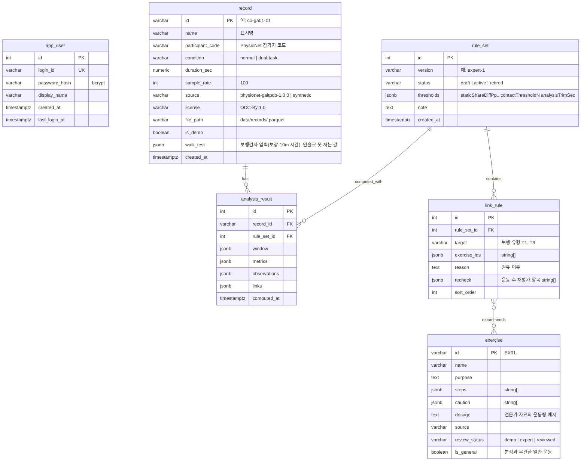

# 0003. 데이터 모델과 저장

기록 메타·운동 콘텐츠·규칙 세트·분석 결과는 PostgreSQL 16에 두고, 센서 시계열은 parquet 파일에 둔 채 DB가 경로로 가리킨다. 스키마는 Alembic이, 초기 데이터는 seed JSON이 정본이다. 전체 구조는 [0001](0001-system-architecture.md), 이 모델을 읽는 API와 계산은 [0004](0004-api-and-analysis.md)에 있다.

## 제안 요약

- 테이블 6개: `app_user`, `record`, `exercise`, `rule_set`, `link_rule`, `analysis_result`. 규칙 세트는 버전이 공존하고 활성 하나만 분석에 쓴다.
- 센서 시계열(10분 × 100 Hz × 18열)은 `backend/data/records/<id>.parquet`. DB 행으로 풀지 않는다.
- 콘텐츠·규칙의 변경 이력은 `backend/data/seed/*.json`을 통해 git이 갖고, 런타임 정본은 DB다.
- PhysioNet 원본은 서버와 분리된 준비 도구가 내려받아 선별·변환한다.

```text
  backend/
    alembic.ini  alembic/versions/   마이그레이션
    data/
      records/<id>.parquet    time, l1..l8, r1..r8, lsum, rsum (100 Hz). record.file_path 가 가리킨다
      seed/records.json       기록 메타 seed
      seed/exercises.json     운동 콘텐츠 seed
      seed/rule_set.json      규칙 세트 seed (임계값 + 유형별 운동 링크)
    tools/
      fetch_physionet.py      원본 내려받기 (wget 목록 기반)
      select_controls.py      demographics 로 대조군 선별 → seed/records.json
      convert.py              txt → parquet
      seed.py                 seed/*.json → DB upsert
```

## 설계

### 테이블과 관계

센서 시계열은 parquet 파일에 두고 DB는 그 파일을 가리키는 메타와 나머지 전부를 갖는다. 규칙 세트는 여러 버전이 공존하고 `status='active'`인 하나를 분석에 쓴다. 분석 결과는 기록×규칙 세트 단위로 캐시한다.



제약: `app_user.login_id` unique. `analysis_result(record_id, rule_set_id)` unique. `rule_set.status='active'`는 partial unique index로 한 행만 허용. `link_rule.exercise_ids`의 각 값은 seed 시점에 `exercise.id` 존재를 검증한다(jsonb라 FK 없음). 규칙 세트가 바뀌면 이전 캐시는 남고 새 세트로 다시 계산된다.

마이그레이션은 Alembic이 갖고, 최초 revision이 위 여섯 테이블을 만든다. seed는 `tools/seed.py`가 `data/seed/*.json`을 upsert하며 여러 번 실행해도 결과가 같다. `app_user`는 seed하지 않는다. 계정은 가입 API로 만들며 비밀번호를 파일에 두지 않는다. 기록·분석 결과는 사용자와 무관한 공용 데이터이며, 개인별 기록이 필요해지면 `record`에 `owner_id`를 더한다. 콘텐츠와 규칙의 변경 이력은 seed JSON을 통해 git이 갖고, 런타임 정본은 DB다.

### 데이터 준비 (서버와 분리)

실제 기록을 붙이기 전까지는 `tools/synth.py`(목업 §5 생성기의 이식)와 `tools/make_records.py`가 `seed/records.json`의 `synth` 정의로 parquet을 만든다. 기록 하나는 10분 × 100 Hz에 약 1.5 MiB다.

PhysioNet 기록으로 바꿀 때의 순서는 다음과 같다.

1. `fetch_physionet.py`가 gaitpdb v1.0.0 파일 목록을 받아 `backend/data/raw/`에 저장한다.
2. `select_controls.py`가 `demographics` 표에서 그룹이 대조군(CO)인 참가자만 고르고, 조건별 기록 파일을 `seed/records.json`에 적는다. 이중 과제 기록은 `condition`으로 구분한다.
3. `convert.py`가 각 txt를 parquet으로 바꾸고 시간축·열 수(19)·단위를 검증한다.
4. `seed.py`가 records·exercises·rule_set을 DB에 upsert 한다. 링크 규칙이 가리키는 운동 ID가 실제로 있는지 먼저 확인하고, 기준이 바뀐 규칙 세트의 분석 캐시는 지운다.
5. 실행 결과·결측·제외 기록은 `docs/reports/`에 experiment-report로 남긴다.

원본 `raw/`는 git에 넣지 않는다. 변환된 parquet 중 시연에 쓰는 소수(10개 안팎)만 커밋한다.

## 결정과 대안

### PostgreSQL + parquet 하이브리드

기록 메타·운동 콘텐츠·규칙 세트·링크·분석 결과는 PostgreSQL 16에 두고, 센서 시계열(10분 × 100 Hz × 18열)은 `backend/data/records/<id>.parquet`에 둔 채 `record.file_path`로 가리킨다. `app` 컨테이너는 `backend/data`를 읽기 전용으로 마운트하고 `DATABASE_URL`로 `db`에 붙는다. SQLAlchemy 2.0 async + asyncpg + Alembic을 쓴다.

배경: 시연만 목적이면 파일로 충분하지만, 사용자는 실제 서비스와 같은 저장 뼈대(모델·마이그레이션·seed)를 남기길 원했고 PostgreSQL이 늘 쓰는 스택이다. 규칙 세트를 DB에 두면 학과 검토값을 재기동 없이 바꾸고 이전 버전과 결과를 비교할 수 있다.

| 대안 | 거절 이유 |
| --- | --- |
| 파일만(parquet + JSON + YAML) | 단순하지만 도메인의 `models.py`·`crud.py`가 빈 껍데기가 되고 규칙 버전 관리·결과 캐시를 직접 구현해야 한다 |
| SQLite | 설치가 없어 편하나 사용자가 쓰지 않는 스택이고 jsonb·partial unique index 같은 제약 표현이 약하다 |
| 시계열까지 DB 행으로 | 기록당 6만 행이고 질의는 "id로 전체 읽기" 하나뿐이다. TimescaleDB 같은 확장은 이 규모에 과하다 |

비용: DB 볼륨이 남아 있으면 seed가 upsert로 갱신하므로 규칙 세트를 지우려면 볼륨을 지워야 한다(runbook). parquet 파일과 DB 행이 어긋날 수 있어 seed와 기동 시 `file_path` 존재를 검사한다. 개인별 기록 저장이 필요해지면 `record`에 소유자 열을 더하는 것으로 확장한다.
